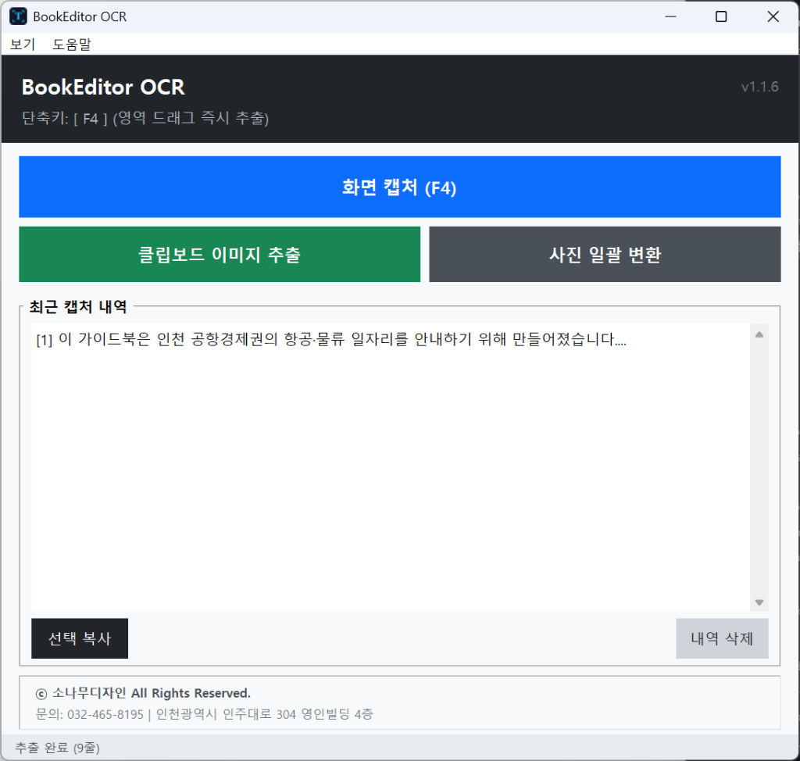
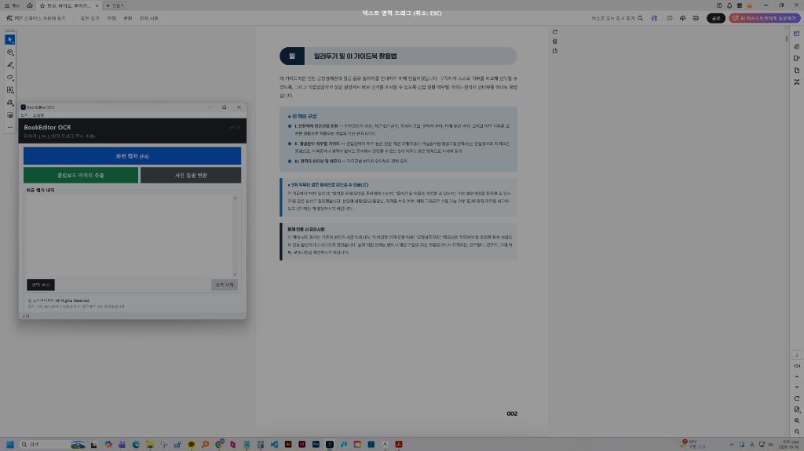
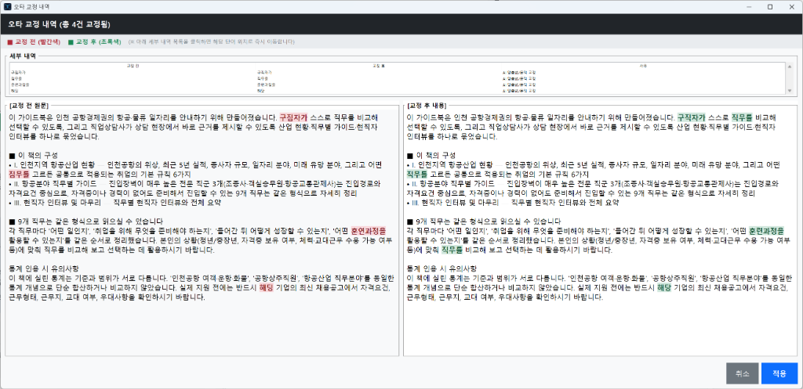
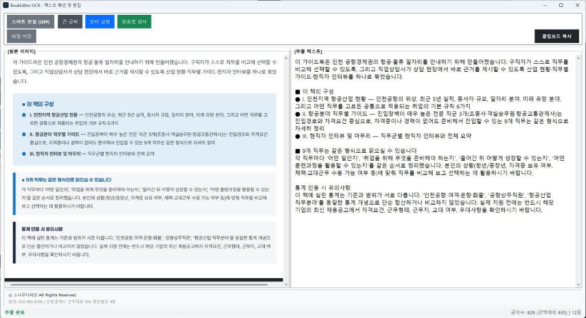
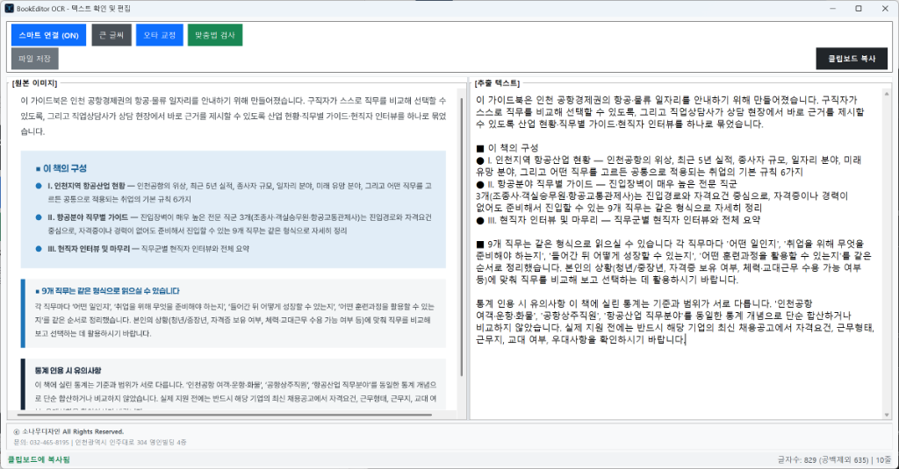
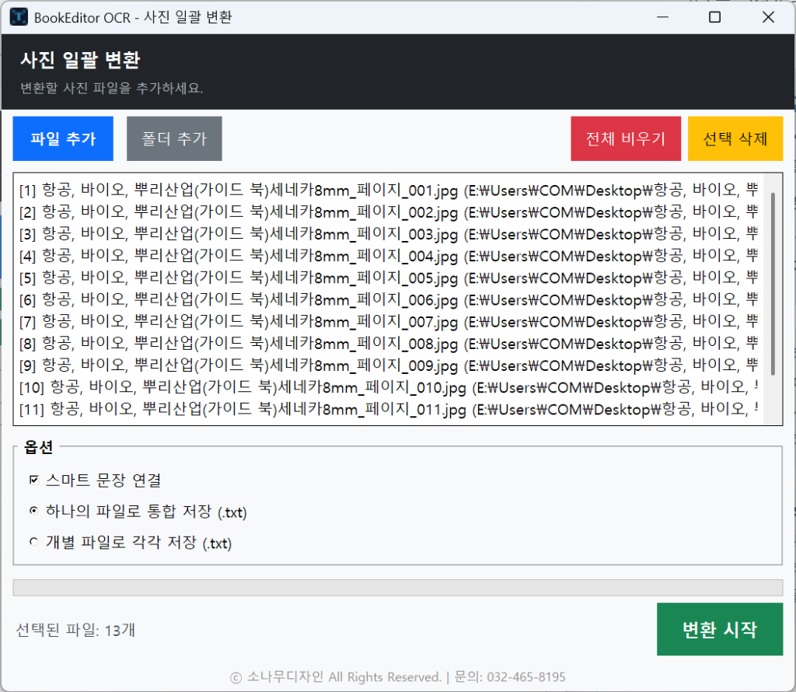
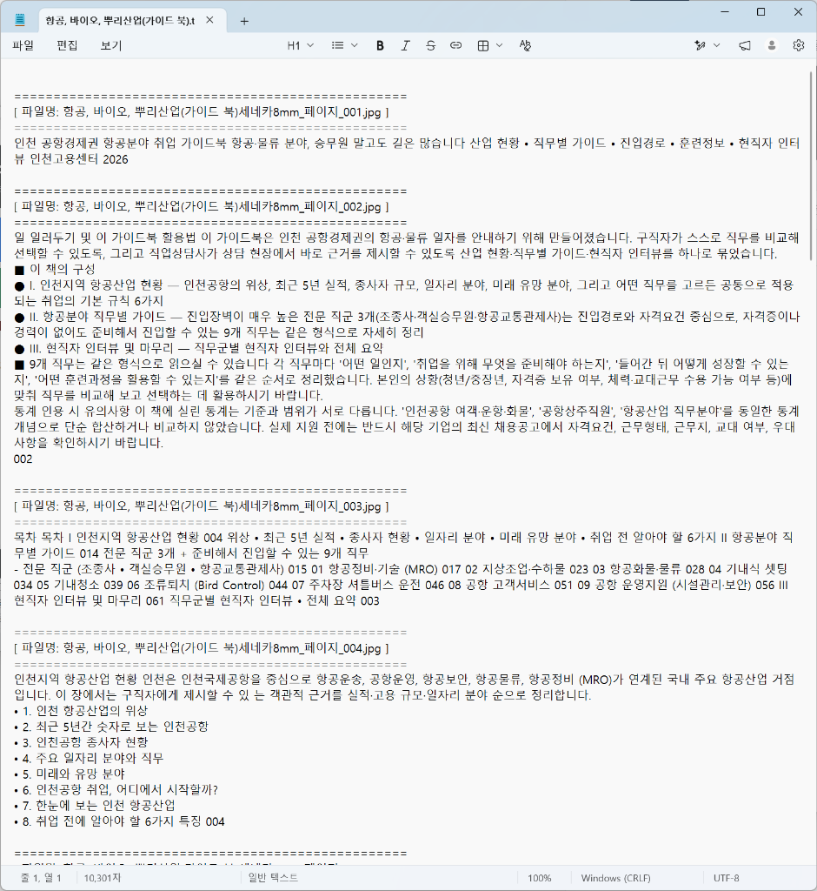

  
  <h1>BookEditor OCR</h1>
  
<strong>출판 및 인쇄 전문 디자이너를 위한 고정밀 한글 도서 본문 OCR & 교정 데스크톱 도구</strong>

---

## 📖 개요 (Overview)

**BookEditor OCR**은 단행본, 도록, 정기간행물 등 출판·인쇄 조판 실무에서 반복되는 텍스트 입력과 오타 검수 과정을 획기적으로 단축하기 위해 개발된 전용 소프트웨어입니다.

작업 중 언제 어디서나 단축키 **`F4`**를 눌러 화면의 원하는 영역을 드래그하면, 초고속 비전 AI가 **1~2초** 만에 텍스트를 판독하여 클립보드에 자동 복사합니다. 작업자는 별도의 복사 과정 없이 **Adobe InDesign, Illustrator, 한글(HWP)** 조판 창에 즉시 붙여넣기(`Ctrl+V`)하여 작업을 이어갈 수 있습니다.

또한, 수십~수백 페이지에 달하는 대용량 도서 스캔 이미지를 한 번에 텍스트 파일로 추출하는 **사진 일괄 변환(배치 처리)** 및 **문맥 기반 AI 오타 교정** 기능을 기본 탑재하고 있습니다.

---

## 🖥️ 실행 화면 및 작업 워크플로우

### 1. 메인 대시보드 및 단축키 대기
> 프로그램을 실행하면 트레이 상주 및 단축키(`F4`) 대기 상태로 전환되며, 최근 추출 내역과 일일 사용량을 한눈에 관리할 수 있습니다.

  

- **화면 캡처 (`F4`)**: 화면 어디서나 즉시 영역 드래그 캡처를 실행합니다.
- **클립보드 이미지 추출**: 이미 클립보드에 캡처된 이미지가 있을 경우 원클릭으로 텍스트를 추출합니다.
- **사진 일괄 변환**: 대량의 페이지 이미지를 한 번에 불러와 텍스트 파일로 일괄 변환합니다.
- **최근 캡처 내역 관리**: 직전에 추출했던 본문들을 보관하며 재복사 및 편집이 가능합니다.

---

### 2. 실제 출판 조판 환경에서의 영역 캡처 (`F4`)
> PDF 뷰어, 인디자인, 웹브라우저 등 작업 화면 위에서 직관적인 십자선 오버레이로 원하는 영역을 지정합니다.

  

---

### 3. AI 문맥 오타 교정 (Diff View)
> 에디터 상단의 `오타 교정` 버튼을 누르면 AI가 본문 전체의 문맥을 분석하여 오탈자 및 띄어쓰기를 검출하고 전후 대조 화면을 제공합니다.

  

> [!NOTE]
> **안내**: 위 스크린샷은 AI 오타 교정 성능을 시연하기 위해, 원문에 **일부러 의도적인 오탈자(구직자가, 직무들, 훈련과정을, 해당 등)를 입력한 뒤 교정 버튼을 실행한 테스트 화면**입니다. OCR 엔진의 오인식 결과가 아닙니다.

- **원문 vs 교정안 색상 하이라이트**: 교정 전 단어는 **빨간색**, 교정 후 단어는 **초록색**으로 표시되어 변경 내역을 한눈에 식별할 수 있습니다.
- **상세 내역 테이블**: 각 교정 항목의 위치와 교정 사유를 표 형태로 제공하며, 더블 클릭 시 해당 위치로 즉시 이동합니다.
- **원클릭 반영**: '적용' 버튼 클릭 시 본문 에디터와 클립보드에 교정본이 즉시 반영됩니다.

---

### 4. 1:1 원본 대조 에디터 & 스마트 연결 (Before & After)
> 캡처 완료 즉시 팝업되는 분할창에서 원본 캡처 이미지(좌)와 추출 텍스트(우)를 1:1로 직접 대조할 수 있습니다.

| 스마트 연결 (OFF) - 기본 모드 | 스마트 연결 (ON) - 문장 연결 모드 |
| :---: | :---: |
|  |  |
| **인쇄물 원본 줄바꿈·빈 줄·표 서식 100% 보존** 인쇄 문서 원형 그대로 조판할 때 최적 | **어색하게 끊어진 문장을 하나의 단락으로 자동 연결** 단행본 본문 텍스트를 재배치할 때 최적 |

- **기본 상태 (`스마트 연결 OFF`)**: 인쇄 원본의 행바꿈과 단락 간 빈 줄, 리스트 기호가 원형 그대로 유지되어 줄바꿈 왜곡이 전혀 없습니다.
- **원클릭 연결 (`스마트 연결 ON`)**: 상단 버튼 클릭 시, 불릿(•, 1., 2.) 항목은 보존하면서 문장 중간에 줄바꿈된 행들을 시원하게 매끄러운 단락으로 연결합니다.
- **자동 클립보드 복사**: 모드를 변경하거나 창이 열릴 때마다 정돈된 텍스트가 클립보드에 즉시 동기화됩니다.

---

### 5. 대용량 도서 일괄 변환 (Batch Processing)
> 수십~수백 장의 도서 스캔 이미지를 폴더 통째로 불러와 단일 `.txt` 통합 파일 또는 페이지별 개별 파일로 고속 자동 변환합니다.

| 일괄 변환 설정 창 | 통합 저장 결과물 (.txt) |
| :---: | :---: |
|  |  |
| **도서 페이지 목록 로드 및 옵션 지정** (스마트 연결 여부 / 통합 저장 / 개별 저장) | **페이지 구분선과 함께 완벽하게 정돈된 텍스트** (인디자인 일괄 조판에 바로 활용) |

---

## ✨ 핵심 기능 요약 (Key Features)

- **초고속 비전 OCR 엔진**: 최신 Gemini Vision 엔진 엔드포인트를 적용하여 1초대 초고속 응답을 보장하며, 복수 API 키 자동 로테이션으로 안정적인 쿼터를 제공합니다.
- **AI 오타 교정 & 한국어 맞춤법 검사기 연동**:
  - `오타 교정`: AI가 원문 문맥을 교정교열 전문가 관점에서 분석하여 띄어쓰기 및 오탈자를 정밀 교정(Diff 비교창 제공).
  - `맞춤법 검사`: 웹 표준 한국어 맞춤법/문법 검사기(나라인포테크) 원클릭 연동.
- **스마트 연결 & 원본 줄바꿈 완벽 보존**: 인쇄물 원형 그대로의 줄바꿈과 표 서식을 보존하거나, 긴 문장을 매끄럽게 연결하는 유연한 토글 지원.
- **손상 글자 스마트 문맥 복원**: 저해상도 캡처나 뭉개진 글자를 한국어 문맥을 통해 본래 단어로 복원하며, 복원된 단어는 `[[단어]]` 형태 및 노란색 핀셋 하이라이트로 시각화됩니다.
- **유니코드 특수기호 온전 전사**: 화살표(→), 불릿(•, ▶), 사칙연산 기호(×, ÷), 괄호 등을 LaTeX나 영문 명령어가 아닌 실제 유니코드 특수문자 그대로 전사합니다.
- **원클릭 자동 업데이트**: GitHub Releases와 연동되어 실행 시 최신 버전을 자동 감지하고 간편하게 패치합니다.

---

## ⌨️ 단축키 및 조작 가이드

| 조작키 / 버튼 | 기능 설명 |
| :--- | :--- |
| **`F4`** | 전역 영역 캡처 실행 (프로그램 최소화 상태에서도 동작) |
| **`ESC`** | 캡처 영역 지정 취소 또는 팝업 에디터 창 닫기 |
| **`오타 교정`** | 출판 문맥 맞춤법/띄어쓰기 교정 분석 및 전후 대조 다이얼로그 실행 |
| **`스마트 연결 (OFF/ON)`** | 원본 줄바꿈 유지(회색) ↔ 문장 자동 이어붙이기(파란색) 원클릭 토글 |
| **`큰 글씨 / 보통 글씨`** | 고해상도 모니터 환경에 맞춘 에디터 본문 글자 크기 확대/축소 |
| **`맞춤법 검사`** | 외부 한국어 맞춤법 검사기 브라우저 원클릭 연동 |
| **`클립보드 복사`** | 하이라이트 태그를 배제한 순수 교정 텍스트 수동 복사 |
| **`파일 저장`** | 현재 편집 텍스트를 `.txt` 파일로 내보내기 |

---

## 🛠️ 기술 사양 (Specifications)

- **개발 언어**: Python 3.12 (64-bit)
- **GUI 프레임워크**: Tkinter (Windows Per-Monitor v2 High-DPI 자동 스케일링 대응)
- **비전 및 교정 AI**: Google Gemini Multimodal REST API
- **이미지 프로세싱**: Pillow (PIL)
- **바이너리 빌드**: Nuitka (핵심 로직 C 기계어 컴파일) + PyInstaller 단일 실행 파일 배포
- **배포 및 업데이트**: GitHub Releases API 연동 자동 패처

---

## 📄 저작권 및 문의 (License & Contact)

ⓒ **소나무디자인** All Rights Reserved.
- **문의처**: 032-465-8195
- **주소**: 인천광역시 인주대로 304 영인빌딩 4층
- 본 소프트웨어는 출판 편집 및 인쇄 조판 업무 생산성 극대화를 위해 개발되었습니다.
